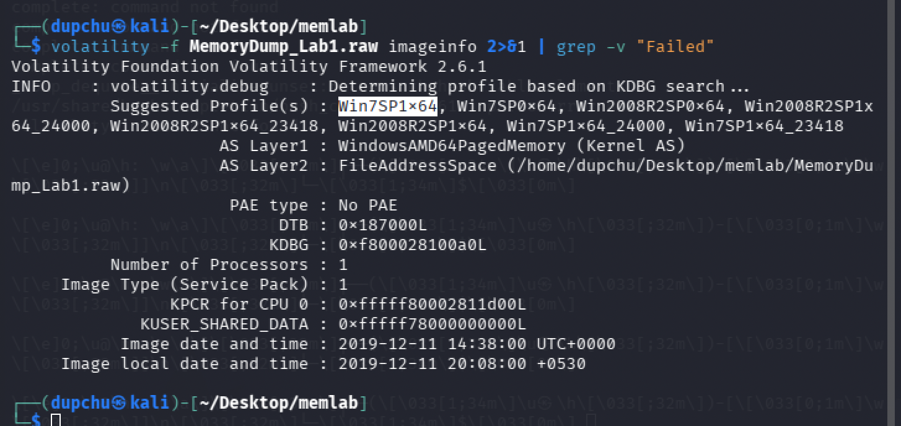
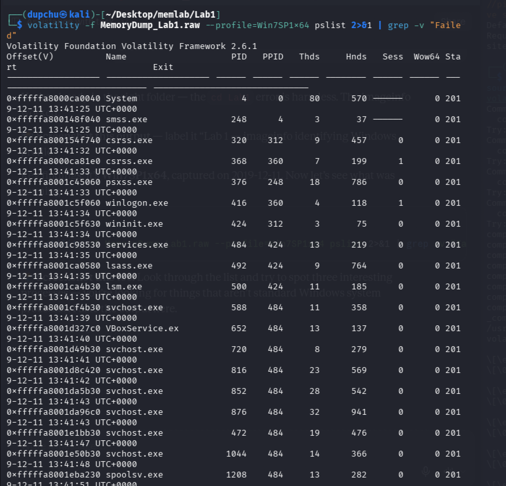
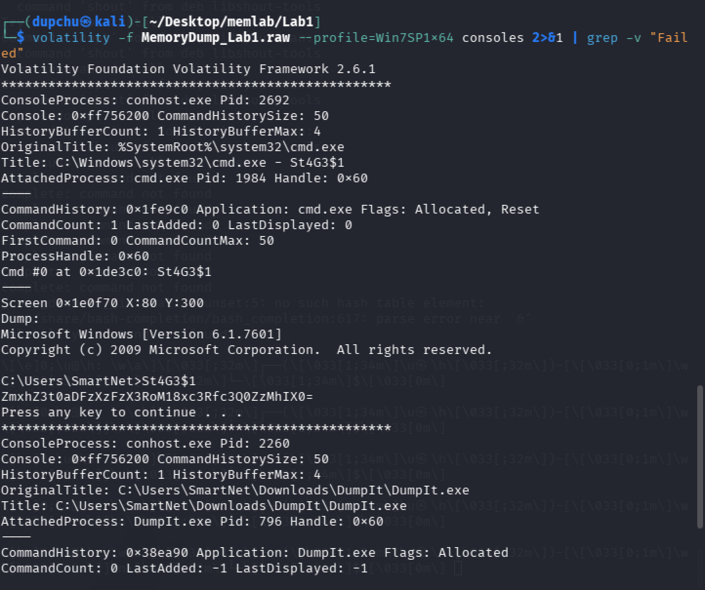
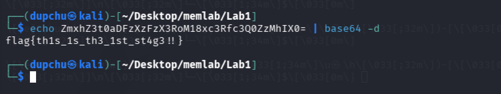
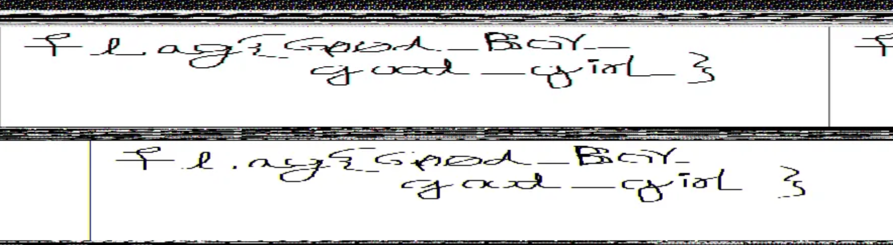
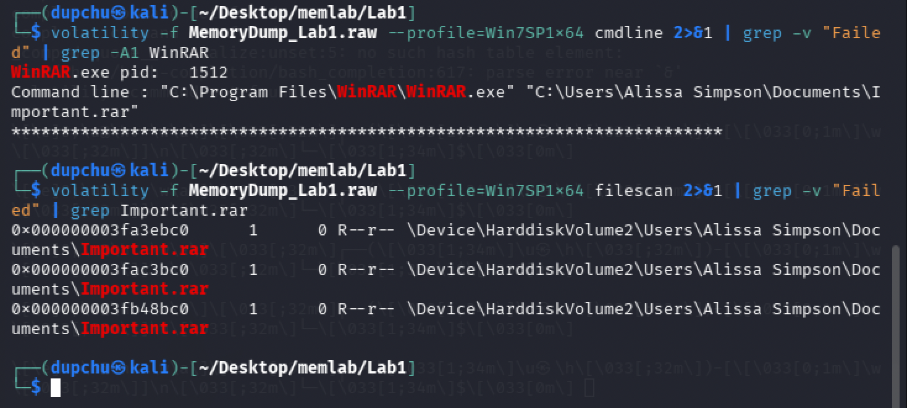
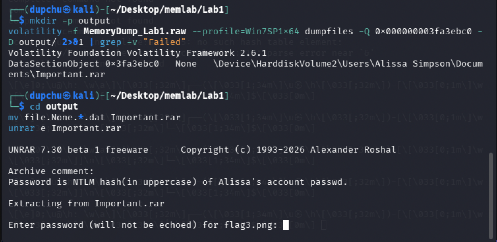
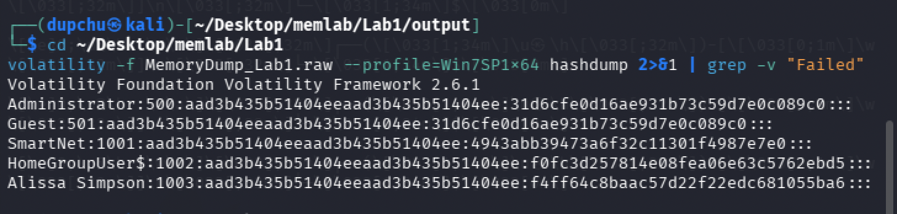
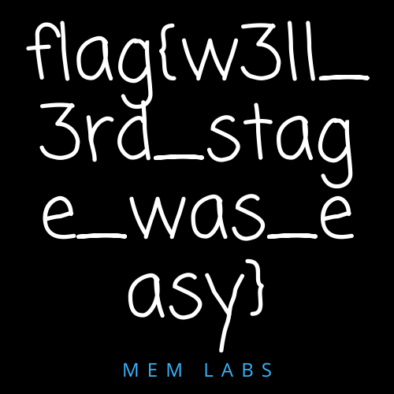

# MemLabs Lab 1 — Beginner's Luck

## 1. Objective

Recover three flags from a memory dump of a crashed Windows system. The user was executing commands, working with an archive manager, and drawing something at the time of the crash.


## 2. Image Identification

The first step was identifying the operating system and profile of the memory image using the `imageinfo` plugin.

```
volatility -f MemoryDump_Lab1.raw imageinfo
```

**Result:** The suggested profile is **Win7SP1x64** (Windows 7, Service Pack 1, 64-bit). The image was captured on 2019-12-11 at 14:38:00 UTC.



## 3. Process Listing

Next, I listed all running processes to understand what the user was doing at the time of the crash.

```
volatility -f MemoryDump_Lab1.raw --profile=Win7SP1x64 pslist
```

Three processes stood out from the normal Windows background services:

- **cmd.exe** (PID 1984) — A command prompt was open, indicating commands were typed.
- **mspaint.exe** (PID 2424) — A drawing application, matching the description that the user was "trying to draw something."
- **WinRAR.exe** (PID 1512) — An archive manager had a file open.
- **DumpIt.exe** (PID 796) — This is the memory acquisition tool used to capture the dump itself, not part of the user's activity.



## 4. Flag 1 — Command Console History (Base64 Decoding)

### Investigation

I used the `consoles` plugin to examine what was typed and displayed in the command prompt.

```
volatility -f MemoryDump_Lab1.raw --profile=Win7SP1x64 consoles
```

The output showed that a command called `St4G3$1` was executed, and it printed a Base64-encoded string:

```
ZmxhZ3t0aDFzXzFzX3RoM18xc3Rfc3Q0ZzMhIX0=
```

I decoded this using:

```
echo ZmxhZ3t0aDFzXzFzX3RoM18xc3Rfc3Q0ZzMhIX0= | base64 -d
```

### Result

**Flag 1: `flag{th1s_1s_th3_1st_st4g3!!}`**





### Forensic Reasoning

The `consoles` plugin works by scanning memory for `CONSOLE_INFORMATION` structures maintained by the `conhost.exe` process. Unlike `cmdscan`, which only recovers the commands typed, `consoles` recovers both the input commands and their screen output. This was the right tool here because the flag was not in the command itself (`St4G3$1`) but in the output it produced — the Base64 string. Base64 is a common encoding scheme used to represent binary data as ASCII text. It is not encryption; it is trivially reversible, which is why a simple `base64 -d` command was sufficient to recover the plaintext flag.


## 5. Flag 2 — MSPaint Process Memory (Image Recovery)

### Investigation

The challenge description stated the user was "trying to draw something," and `mspaint.exe` (PID 2424) was running. I dumped the process memory using the `memdump` plugin:

```
volatility -f MemoryDump_Lab1.raw --profile=Win7SP1x64 memdump -p 2424 -D output/
```

The output file `2424.dmp` was renamed to `2424.data` to allow GIMP to open it as raw image data:

```
mv output/2424.dmp output/2424.data
gimp output/2424.data
```

In GIMP, I opened it as "Raw image data" with the following settings:
- Image Type: RGB Alpha
- Width: adjusted through trial and error (tried 1024, 1280, etc.)
- Offset: adjusted until the drawing became visible

The image appeared flipped, so I applied:
- Image → Transform → Rotate 180°
- Image → Transform → Flip Horizontally

### Result

**Flag 2: `flag{G00d_Boy_good_girL}`**



### Forensic Reasoning

The `memdump` plugin dumps the full addressable memory of a process, not just its files. MSPaint holds its active canvas as a bitmap in process memory even though it may not have been saved to disk. By dumping the raw process memory and interpreting it as pixel data in GIMP, we can visually reconstruct what was on the canvas. This demonstrates that volatile data (unsaved work in an application) can be recovered from a memory image — a key principle of memory forensics. The trial-and-error with width and offset is necessary because raw memory does not contain image headers specifying dimensions; the analyst must manually find the correct stride.


## 6. Flag 3 — WinRAR Archive (Password Hash Recovery)

### Investigation

I identified that WinRAR.exe (PID 1512) had an archive open. Using `cmdline`, I found the file path:

```
volatility -f MemoryDump_Lab1.raw --profile=Win7SP1x64 cmdline | grep WinRAR
```

**Output:** WinRAR had opened `C:\Users\Alissa Simpson\Documents\Important.rar`.

I then located the file in memory using `filescan`:

```
volatility -f MemoryDump_Lab1.raw --profile=Win7SP1x64 filescan | grep Important.rar
```

This returned three offsets. I used `dumpfiles` to extract it:

```
volatility -f MemoryDump_Lab1.raw --profile=Win7SP1x64 dumpfiles -Q 0x000000003fa3ebc0 -D output/
mv output/file.None.0xfffffa8001034450.dat Important.rar
unrar e Important.rar
```

The archive was password-protected. The embedded comment read: **"Password is NTLM hash (in uppercase) of Alissa's account passwd."**





I used the `hashdump` plugin to recover Windows account password hashes:

```
volatility -f MemoryDump_Lab1.raw --profile=Win7SP1x64 hashdump
```

**Alissa Simpson's NTLM hash:** `f4ff64c8baac57d22f22edc681055ba6`



I converted the hash to uppercase (`F4FF64C8BAAC57D22F22EDC681055BA6`) and used it as the password. The archive contained `flag3.png`.

### Result

**Flag 3: `flag{w3ll_3rd_stage_was_easy}`**



### Forensic Reasoning

The `hashdump` plugin extracts password hashes from the Windows SAM (Security Accounts Manager) registry hive, which is loaded into memory. Windows stores two hashes per account: the legacy LM hash (filled with a dummy value `aad3b435b51404eeaad3b435b51404ee` on modern systems since Vista) and the NTLM hash. The NTLM hash is a direct MD4 hash of the user's password. While the actual password is not stored or recoverable from the hash alone, the hash itself can be used as a credential — in this case, as an archive password. This demonstrates how memory forensics can recover authentication material that exists only in volatile memory, and how credentials from one artifact (the SAM hive) can unlock evidence in another (the RAR archive). The `filescan` and `dumpfiles` plugins work together: `filescan` locates file objects in kernel memory by scanning for `_FILE_OBJECT` structures, and `dumpfiles` uses the physical offset to extract the file's data sections from memory.


## 7. Summary of Flags

| Flag | Value | Method |
|------|-------|--------|
| Flag 1 | `flag{th1s_1s_th3_1st_st4g3!!}` | consoles plugin → Base64 decode |
| Flag 2 | `flag{G00d_Boy_good_girL}` | memdump of mspaint.exe → GIMP raw image |
| Flag 3 | `flag{w3ll_3rd_stage_was_easy}` | filescan → dumpfiles → hashdump → unrar |

## 8. Dead Ends and Additional Notes

- Initially ran `cmdscan` before `consoles`. `cmdscan` only showed the command name `St4G3$1` but not its output. Switching to `consoles` revealed the full screen buffer including the Base64 string.
- The GIMP raw data import required trial and error with width, offset, and pixel format settings before the flag became readable.
- Multiple offsets were returned by `filescan` for Important.rar — any of the three could be used with `dumpfiles`.