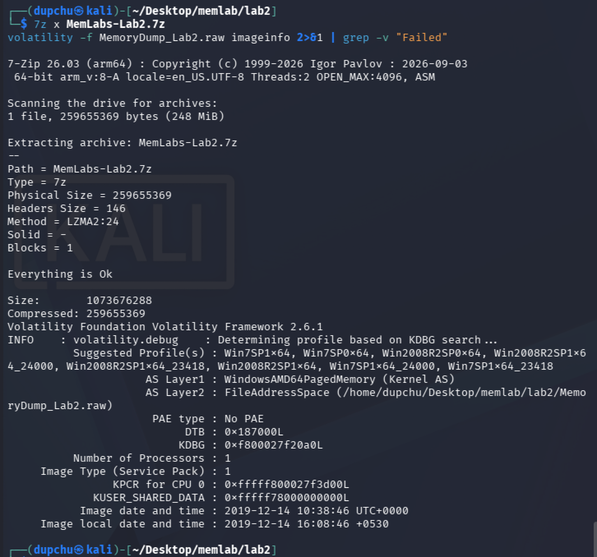
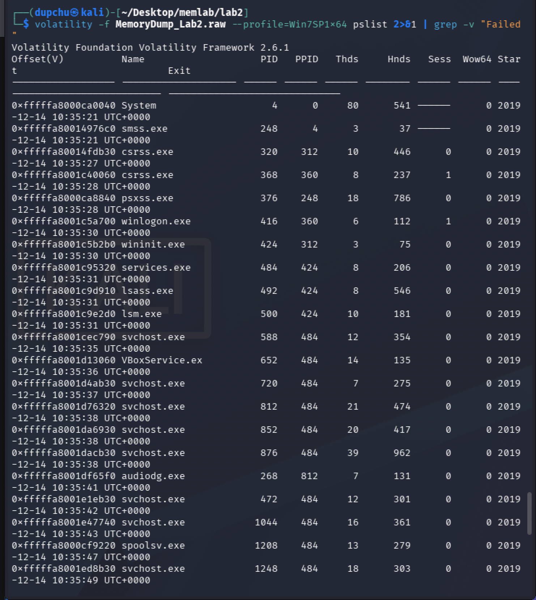
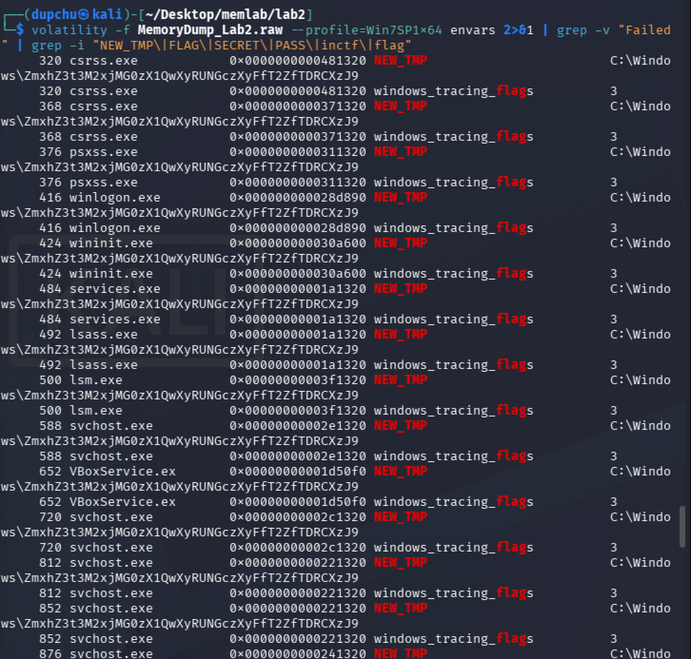
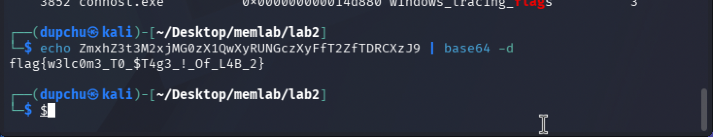
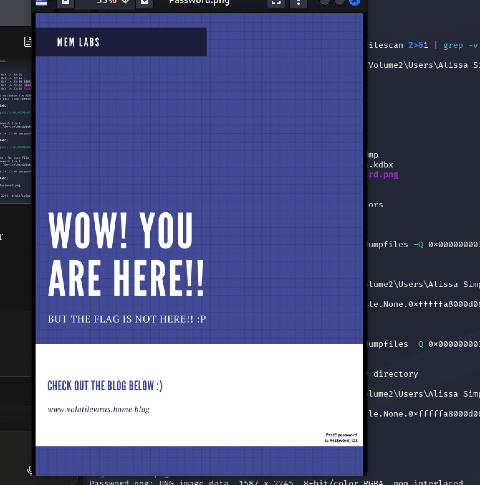
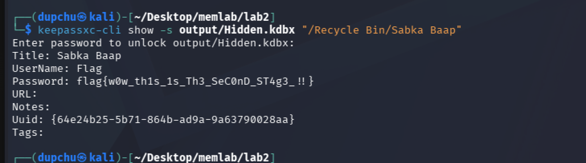
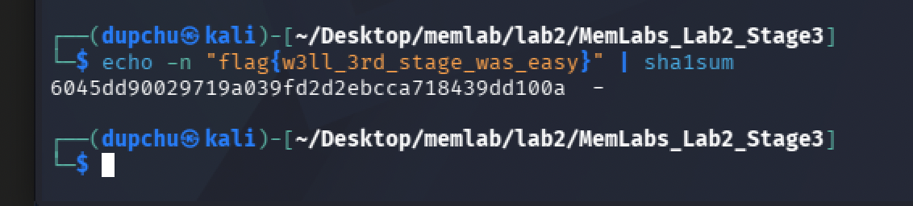
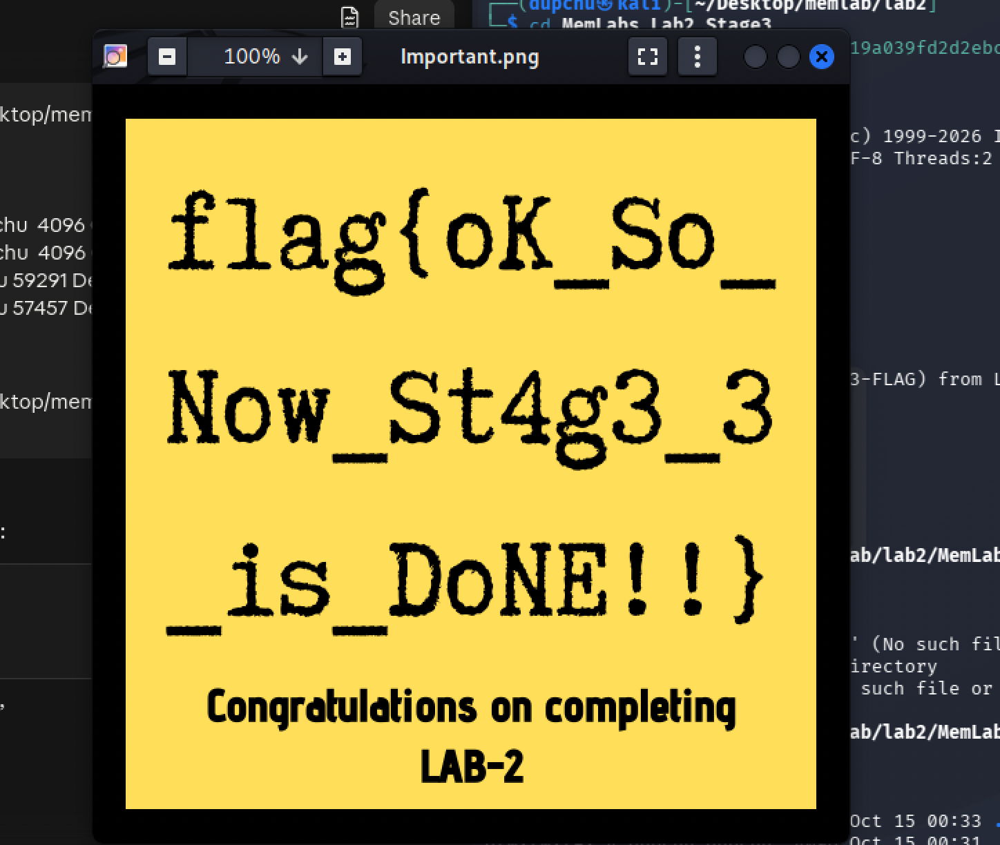

# MemLabs Lab 2 — A New World


## 1. Objective

Recover three flags from a Windows 7 memory image containing an active browser session and a password manager. One flag requires a flag from Lab 1 to derive a password.


## 2. Image Identification

The first step was identifying the operating system profile using the `imageinfo` plugin.

```
volatility -f MemoryDump_Lab2.raw imageinfo
```

**Result:** The suggested profile is **Win7SP1x64** (Windows 7, Service Pack 1, 64-bit). The image was captured on 2019-12-14 at 10:38:46 UTC.



## 3. Process Listing

I listed all running processes to understand what the user was doing at the time.

```
volatility -f MemoryDump_Lab2.raw --profile=Win7SP1x64 pslist
```

Key processes identified:

- **chrome.exe** (PID 2296, with several child processes) — An active Google Chrome browser session.
- **KeePass.exe** (PID 3008) — A password manager application, indicating credentials were being managed.
- **notepad.exe** (PID 3260) — A text editor was open.
- **cmd.exe** (PID 2096) — A command prompt was open.
- **DumpIt.exe** (PID 3844) — The memory acquisition tool, not part of the user's activity.



## 4. Flag 1 — Environment Variables (Base64 Decoding)

### Investigation

The challenge description quoted the word "environmental," hinting at environment variables. I used the `envars` plugin to check for suspicious variables.

```
volatility -f MemoryDump_Lab2.raw --profile=Win7SP1x64 envars | grep -i "NEW_TMP\|FLAG\|SECRET"
```

Every process on the system contained a non-standard environment variable called `NEW_TMP` with the value:

```
C:\Windows\ZmxhZ3t3M2xjMG0zX1QwXyRUNGczXyFfT2ZfTDRCXzJ9
```

The string after `C:\Windows\` is clearly Base64-encoded. I decoded it:

```
echo ZmxhZ3t3M2xjMG0zX1QwXyRUNGczXyFfT2ZfTDRCXzJ9 | base64 -d
```

### Result

**Flag 1: `flag{w3lc0m3_T0_$T4g3_!_Of_L4B_2}`**





### Forensic Reasoning

The `envars` plugin enumerates environment variables for every process by walking the Process Environment Block (PEB) in each process's memory space. Environment variables are set at the system or user level and inherited by all processes at launch. The `NEW_TMP` variable was present across every process, indicating it was set as a system-level environment variable before any of these processes started. This demonstrates that environment variables can serve as hidden storage for data — because they persist in every process's memory, they are highly recoverable even if the original configuration was later changed or deleted. Attackers and CTF designers alike use this technique because environment variables are rarely inspected during a casual system review.


## 5. Flag 2 — KeePass Password Database (Credential Recovery)

### Investigation

KeePass (PID 3008) was running, so I searched for its database file (`.kdbx` extension):

```
volatility -f MemoryDump_Lab2.raw --profile=Win7SP1x64 filescan | grep ".kdbx"
```

**Result:** `\Users\SmartNet\Secrets\Hidden.kdbx` found at offset `0x000000003fb112a0`.

I dumped the file:

```
volatility -f MemoryDump_Lab2.raw --profile=Win7SP1x64 dumpfiles -Q 0x000000003fb112a0 -D output/
```

The database required a master password. I searched for password-related files in memory:

```
volatility -f MemoryDump_Lab2.raw --profile=Win7SP1x64 filescan | grep -i "password"
```

This revealed `\Users\Alissa Simpson\Pictures\Password.png` at offset `0x000000003fce1c70`. I dumped and opened it:

```
volatility -f MemoryDump_Lab2.raw --profile=Win7SP1x64 dumpfiles -Q 0x000000003fce1c70 -D output/
```



The image contained the text: **Psst! password is P4SSw0rd_123**

I used this password to open the KeePass database and listed entries in the Recycle Bin:

```
keepassxc-cli ls output/Hidden.kdbx "/Recycle Bin/"
```

Three entries appeared: "Sample Entry", "Sample Entry #2", and "Sabka Baap". I examined the suspicious "Sabka Baap" entry:

```
keepassxc-cli show -s output/Hidden.kdbx "/Recycle Bin/Sabka Baap"
```

### Result

**Flag 2: `flag{w0w_th1s_1s_Th3_SeC0nD_ST4g3_!!}`**

The flag was stored as the password field of a deleted KeePass entry in the Recycle Bin.



### Forensic Reasoning

This flag demonstrates multiple forensic principles working together. First, the `filescan` plugin scans kernel memory for `_FILE_OBJECT` structures, which allowed us to locate both the KeePass database and the Password.png image even though we had no prior knowledge of their filenames or locations. Second, the KeePass Recycle Bin is significant because "deleted" entries within a password manager are not truly gone — they are moved to an internal Recycle Bin within the `.kdbx` database, much like Windows' own Recycle Bin. An investigator who only checked active entries would have missed this flag entirely. Third, the master password was stored as an image file rather than plain text — a reminder that sensitive data can hide in unexpected file types, and that a thorough forensic examination checks all file types, not just documents.


## 6. Flag 3 — Chrome Browser History (Cross-Lab Password Derivation)

### Investigation

I used the `chromehistory` community plugin to examine the user's browsing history:

```
volatility --plugins=/home/dupchu/volatility-plugins -f MemoryDump_Lab2.raw --profile=Win7SP1x64 chromehistory
```

Among the URLs visited, one stood out:

```
https://mega.nz/#F!TrgSQQTS!H0ZrUzF0B-ZKNM3y9E76lg
```

This is a link to a MEGA cloud storage folder. I downloaded the contents, which included a password-protected zip file called `Important.zip`.

The instructions bundled with the file indicated the password was the **SHA1 hash of Lab 1's third flag** (`flag{w3ll_3rd_stage_was_easy}`):

```
echo -n "flag{w3ll_3rd_stage_was_easy}" | sha1sum
```

**Result:** `6045dd90029719a039fd2d2ebcca718439dd100a`



I used this hash as the password to extract the archive:

```
7z x Important.zip -p6045dd90029719a039fd2d2ebcca718439dd100a
```

The archive contained `Important.png` with the flag.

### Result

**Flag 3: `flag{oK_So_Now_St4g3_3_is_DoNE!!}`**



### Forensic Reasoning

This flag demonstrates how browser history analysis can lead to external evidence. The `chromehistory` plugin is a community-contributed plugin (not built into Volatility) that parses Chrome's SQLite history database directly from memory. It was the correct choice here because the user was browsing with Chrome — the built-in `iehistory` plugin only works with Internet Explorer. The cross-lab password derivation (SHA1 hash of a previous flag) illustrates a real-world forensic scenario: evidence from one case or artifact can unlock another. The SHA1 hash function is a one-way cryptographic transformation — knowing the hash alone would not reveal the password, but knowing the original flag from Lab 1 made it trivial to compute. This connection between labs mirrors how digital forensic investigations often link evidence across multiple sources.


## 7. Summary of Flags

| Flag | Value | Method |
|------|-------|--------|
| Flag 1 | `flag{w3lc0m3_T0_$T4g3_!_Of_L4B_2}` | envars plugin → Base64 decode |
| Flag 2 | `flag{w0w_th1s_1s_Th3_SeC0nD_ST4g3_!!}` | filescan → dumpfiles (Password.png + Hidden.kdbx) → KeePass Recycle Bin |
| Flag 3 | `flag{oK_So_Now_St4g3_3_is_DoNE!!}` | chromehistory → MEGA download → SHA1 of Lab 1 Flag 3 as password |


## 8. Dead Ends and Additional Notes

- Initially attempted to crack the NTLM hash from `hashdump` to use as the KeePass master password. This was a reasonable approach (it worked in Lab 1), but the KeePass password turned out to be a plaintext string stored in an image file rather than derived from a Windows credential.
- The NTLM hash for Alissa Simpson (`f4ff64c8baac57d22f22edc681055ba6`) was cracked via CrackStation to the plaintext `goodmorningindia`, but this was not the KeePass master password.
- The initial dump of `Hidden.kdbx` was only 4096 bytes (one memory page), suggesting the file's data sections were only partially resident in memory. The database still opened correctly with the right password despite the small dump size.
- The `consoles` and `cmdscan` plugins were also checked but the command prompt did not contain relevant evidence for this lab.