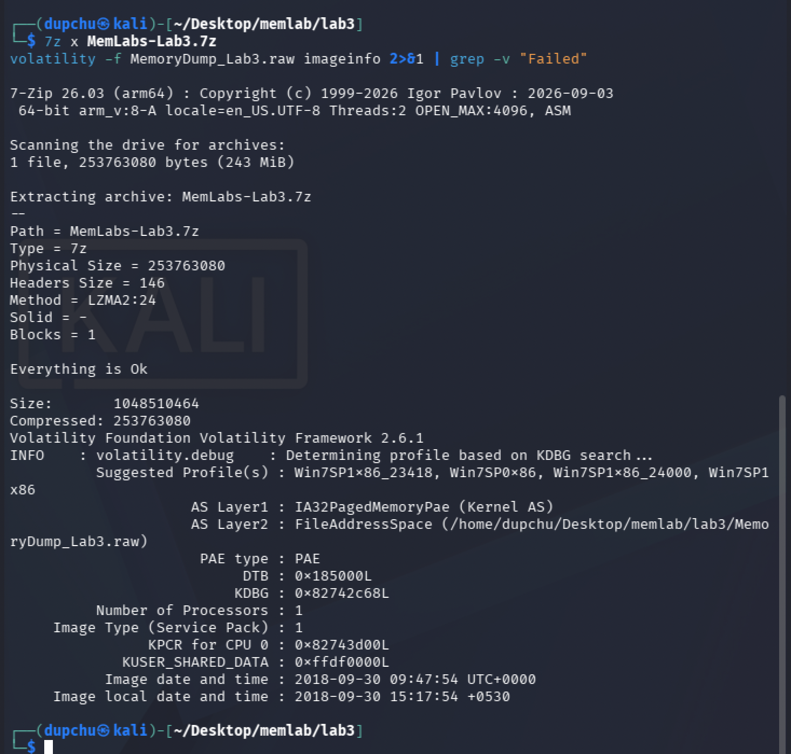
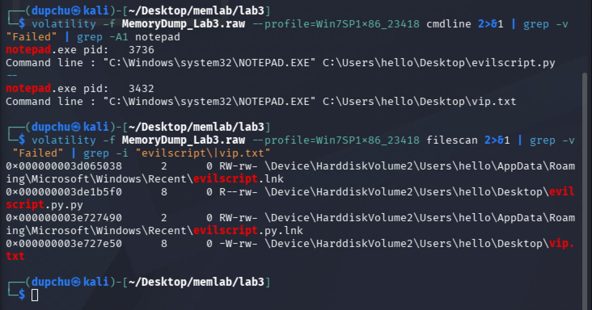
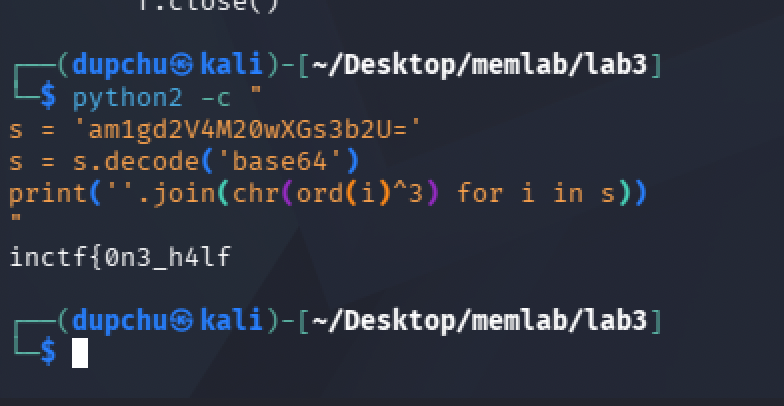
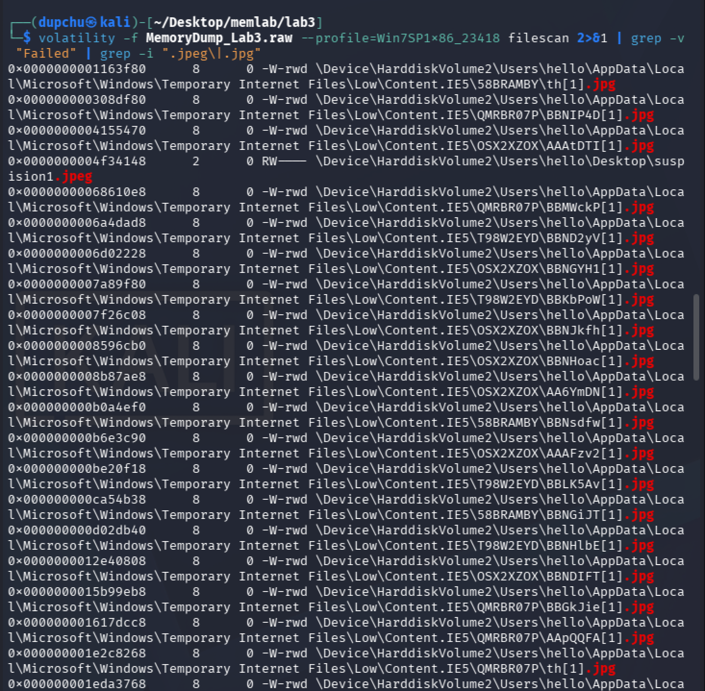
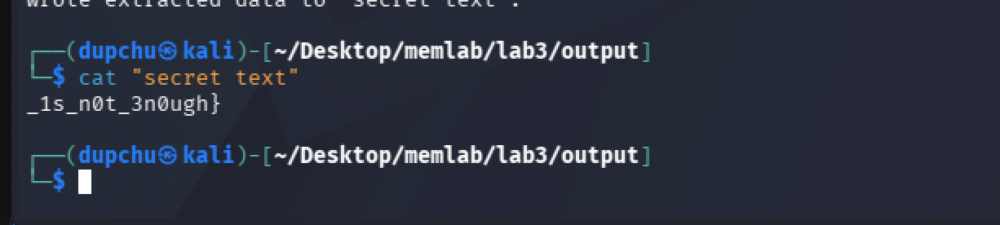

# MemLabs Lab 3 — The Evil's Den
## 1. Objective

Recover a single flag (split into two halves) from a Windows 7 memory image. A malicious script has encrypted secret information, and steganography hides the second half of the flag within an image file. The flag format for this lab is `inctf{...}`.


## 2. Image Identification

I identified the operating system profile using the `imageinfo` plugin.

```
volatility -f MemoryDump_Lab3.raw imageinfo
```

**Result:** The suggested profile is **Win7SP1x86_23418** — notably a **32-bit** Windows 7 image, unlike the 64-bit images in Labs 1 and 2. The image was captured on 2018-09-30 at 09:47:54 UTC.



## 3. Process Investigation

I checked the command-line arguments of all running processes to identify what the user had open.

```
volatility -f MemoryDump_Lab3.raw --profile=Win7SP1x86_23418 cmdline | grep -A1 notepad
```

Two instances of Notepad were running, each with a file open:

- **notepad.exe** (PID 3736) — editing `C:\Users\hello\Desktop\evilscript.py`
- **notepad.exe** (PID 3432) — editing `C:\Users\hello\Desktop\vip.txt`

The first file is a Python script (the "evil script" referenced in the challenge description), and the second is its output — the encrypted data we need to recover.



## 4. Flag — First Half (Reversing the Malicious Script)

### Investigation

I located both files in memory using `filescan`:

```
volatility -f MemoryDump_Lab3.raw --profile=Win7SP1x86_23418 filescan | grep -i "evilscript\|vip.txt"
```

**Results:**
- `evilscript.py.py` at offset `0x000000003de1b5f0`
- `vip.txt` at offset `0x000000003e727e50`

I dumped both files:

```
volatility -f MemoryDump_Lab3.raw --profile=Win7SP1x86_23418 dumpfiles -Q 0x000000003de1b5f0 -D output/
volatility -f MemoryDump_Lab3.raw --profile=Win7SP1x86_23418 dumpfiles -Q 0x000000003e727e50 -D output/
```

### The Malicious Script (evilscript.py)

```python
import sys
import string

def xor(s):
    a = ''.join(chr(ord(i)^3) for i in s)
    return a

def encoder(x):
    return x.encode("base64")

if __name__ == "__main__":
    f = open("C:\\Users\\hello\\Desktop\\vip.txt", "w")
    arr = sys.argv[1]
    arr = encoder(xor(arr))
    f.write(arr)
    f.close()
```

### Analysis of the Script

The script performs two transformations on its input:

1. **XOR with 3:** Each character is XORed with the value 3 (`ord(i) ^ 3`). XOR is a symmetric operation — applying it twice with the same key returns the original value, meaning the same function can both encrypt and decrypt.
2. **Base64 encoding:** The XORed result is then Base64-encoded before being written to `vip.txt`.

The contents of `vip.txt` were:

```
am1gd2V4M20wXGs3b2U=
```

### Reversing the Transformation

To recover the original text, I reversed the operations in the opposite order — first Base64-decode, then XOR with 3:

```
python2 -c "
s = 'am1gd2V4M20wXGs3b2U='
s = s.decode('base64')
print(''.join(chr(ord(i)^3) for i in s))
"
```

### Result

**First half of the flag: `inctf{0n3_h4lf`**



## 5. Flag — Second Half (Steganography Extraction)

### Investigation

The challenge hint states: "You'll need the first half of the flag to get the second." This, combined with the requirement to install `steghide`, indicated that steganography was involved. I searched memory for JPEG images:

```
volatility -f MemoryDump_Lab3.raw --profile=Win7SP1x86_23418 filescan | grep -i ".jpeg\|.jpg"
```

Among dozens of browser cache images, one stood out on the user's Desktop:

```
0x0000000004f34148  \Device\HarddiskVolume2\Users\hello\Desktop\suspision1.jpeg
```

The filename "suspision1" (a misspelling of "suspicion") looked deliberately planted and out of place compared to the generic browser cache files.



I dumped the file:

```
volatility -f MemoryDump_Lab3.raw --profile=Win7SP1x86_23418 dumpfiles -Q 0x0000000004f34148 -D output/
mv output/file.None.0x843fcf38.dat output/suspision1.jpeg
```

### Steghide Extraction

I used `steghide` to extract hidden data from the image, using the first half of the flag as the passphrase:

```
steghide extract -sf output/suspision1.jpeg
Enter passphrase: inctf{0n3_h4lf
wrote extracted data to "secret text".
```

Reading the extracted file:

```
cat "secret text"
_1s_n0t_3n0ugh}
```

### Result

**Second half: `_1s_n0t_3n0ugh}`**

**Complete flag: `inctf{0n3_h4lf_1s_n0t_3n0ugh}`**



## 6. Forensic Reasoning

### Why the reversing approach worked (First Half)

The `evilscript.py` applies a two-stage transformation: XOR followed by Base64 encoding. XOR encryption with a single-byte key is one of the weakest forms of encryption — it is trivially reversible because XOR is its own inverse (applying XOR with the same key twice returns the original data). Base64 is not encryption at all; it is an encoding scheme that represents binary data as ASCII characters. By reading the script carefully rather than guessing, I could reverse the operations in the correct order (Base64 decode first, then XOR) to recover the plaintext. This demonstrates why understanding the logic of a script found during an investigation is more valuable than blindly running tools — the analyst must comprehend the transformation to reverse it.

### Why steganography was the right approach (Second Half)

Steganography is the practice of hiding data within ordinary-looking files such as images or audio. The `steghide` tool embeds data into JPEG and BMP files by modifying pixel values in ways that are imperceptible to the human eye. The image `suspision1.jpeg` appeared to be a normal photograph, but it contained hidden data accessible only with the correct passphrase. The challenge design linked the two halves by using the first half of the flag as the steghide passphrase — demonstrating how evidence from one artifact can unlock another, a principle that recurs throughout forensic investigations. The `filescan` plugin was essential for locating this image because it systematically scans all file objects in kernel memory, including files that might not appear in directory listings.

## 7. Summary

| Flag | Value | Method |
|------|-------|--------|
| Complete Flag | `inctf{0n3_h4lf_1s_n0t_3n0ugh}` | Reverse XOR+Base64 script → first half used as steghide passphrase → second half |


## 8. Dead Ends and Additional Notes

- The `filescan` output for JPEG files returned over 100 results, mostly browser cache images from Internet Explorer's Temporary Internet Files. The key to identifying the correct file was noting that `suspision1.jpeg` was the only image on the user's Desktop, and its misspelled name made it stand out from the cache files.
- Initially checked `consoles` and `cmdscan` for command-line history, but no relevant commands were found — the notepad processes and their `cmdline` arguments were the primary evidence source.
- The profile for this lab was `Win7SP1x86_23418` (32-bit), different from the `Win7SP1x64` profile used in Labs 1 and 2. Using the correct profile is essential — an incorrect profile will cause plugins to return no results or garbage data.