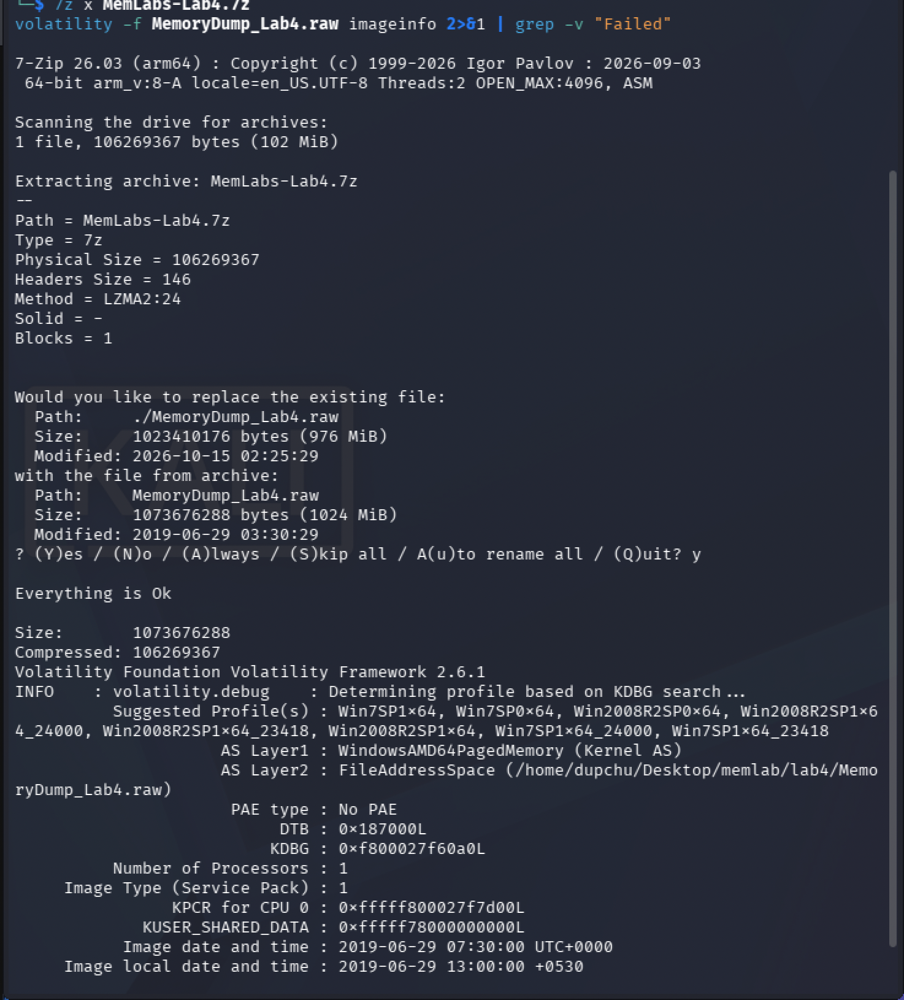
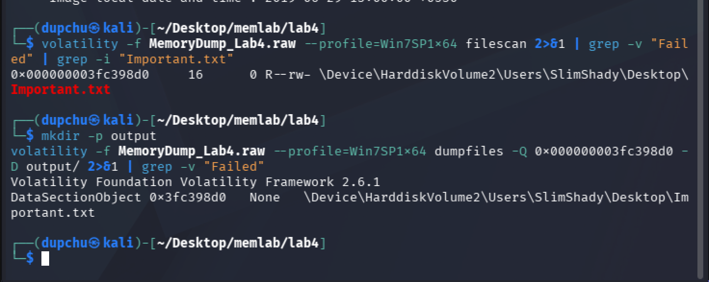
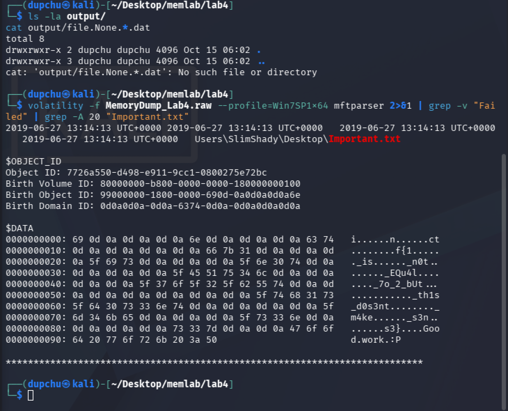

# MemLabs Lab 4 — Obsession

## 1. Objective

Recover a single flag from a Windows 7 memory image where a hacker has deleted an important file. The core forensic challenge is recovering a file that conventional extraction tools cannot retrieve. The flag format is `inctf{...}`.


## 2. Image Identification

I identified the operating system profile using the `imageinfo` plugin.

```
volatility -f MemoryDump_Lab4.raw imageinfo
```

**Result:** The suggested profile is **Win7SP1x64** (Windows 7, Service Pack 1, 64-bit). The image was captured on 2019-06-29 at 07:30:00 UTC.




## 3. Process Investigation

I listed running processes to understand the system state.

```
volatility -f MemoryDump_Lab4.raw --profile=Win7SP1x64 pslist
```

The process list showed standard Windows services and one notable application — `StikyNot.exe` (Sticky Notes). I investigated it briefly but it contained no relevant evidence, making it a deliberate distraction (documented below in Dead Ends).


## 4. Locating the Deleted File

### Finding the File with filescan

The challenge description mentions a deleted file. I used `filescan` to locate any interesting files on the Desktop:

```
volatility -f MemoryDump_Lab4.raw --profile=Win7SP1x64 filescan | grep -i "Important.txt"
```

**Result:**

```
0x000000003fc398d0  R--rw-  \Device\HarddiskVolume2\Users\SlimShady\Desktop\Important.txt
```

The file still appeared in the file object listing, meaning its `_FILE_OBJECT` structure was still in kernel memory even though the file itself had been deleted.



### Attempting dumpfiles (Documented Dead End)

I attempted to extract the file using the standard `dumpfiles` plugin:

```
volatility -f MemoryDump_Lab4.raw --profile=Win7SP1x64 dumpfiles -Q 0x000000003fc398d0 -D output/
```

**Result:** The command reported the `DataSectionObject` but produced **no output file** in the output directory. The output folder was empty.

```
$ ls -la output/
total 8
drwxrwxr-x 2 dupchu dupchu 4096 Oct 15 06:02 .
drwxrwxr-x 3 dupchu dupchu 4096 Oct 15 06:02 ..
```

This confirmed the file had been deleted — the `_FILE_OBJECT` metadata remained in memory, but the actual data sections that `dumpfiles` relies on to extract file contents had been freed. This is a critical forensic observation: a file appearing in `filescan` does not guarantee it can be extracted, because `filescan` finds kernel structures (metadata) while `dumpfiles` needs the actual data pages mapped into memory.


## 5. Flag — MFT-Based Recovery

### Understanding the NTFS Master File Table (MFT)

Since `dumpfiles` failed, I turned to the NTFS Master File Table. The MFT is a core structure of the NTFS file system that stores metadata for every file on a volume. Key facts relevant to this recovery:

- Every file on an NTFS volume has at least one MFT entry, which records the filename, timestamps, permissions, and size.
- For small files (under approximately 1024 bytes), the file's actual data content is stored directly inside the MFT entry itself — this is called a "resident" file.
- When a file is deleted, its MFT entry is marked as free but not immediately overwritten. The data can persist in the MFT record for some time.
- Because the MFT is a large, frequently-accessed structure, portions of it are often resident in physical memory and can be recovered from a memory dump.

### Using mftparser

I used the `mftparser` plugin to parse MFT records from memory and searched for the deleted file:

```
volatility -f MemoryDump_Lab4.raw --profile=Win7SP1x64 mftparser | grep -A 20 "Important.txt"
```

**Result:** The MFT entry for `Important.txt` was found, complete with its `$DATA` attribute containing the file's content:

```
$DATA
0000000000: 69 0d 0a 0d 0a 0d 0a 6e 0d 0a 0d 0a 0d 0a 63 74   i......n......ct
0000000010: 0d 0a 0d 0a 0d 0a 0d 0a 66 7b 31 0d 0a 0d 0a 0d   ........f{1.....
0000000020: 0a 5f 69 73 0d 0a 0d 0a 0d 0a 5f 6e 30 74 0d 0a   ._is......_n0t..
0000000030: 0d 0a 0d 0a 0d 0a 5f 45 51 75 34 6c 0d 0a 0d 0a   ......_EQu4l....
0000000040: 0d 0a 0d 0a 5f 37 6f 5f 32 5f 62 55 74 0d 0a 0d   ...._7o_2_bUt...
0000000050: 0a 0d 0a 0d 0a 0d 0a 0d 0a 0d 0a 5f 74 68 31 73   ..........._th1s
0000000060: 5f 64 30 73 33 6e 74 0d 0a 0d 0a 0d 0a 0d 0a 5f   _d0s3nt........_
0000000070: 6d 34 6b 65 0d 0a 0d 0a 0d 0a 5f 73 33 6e 0d 0a   m4ke......_s3n..
0000000080: 0d 0a 0d 0a 0d 0a 73 33 7d 0d 0a 0d 0a 47 6f 6f   ......s3}....Goo
0000000090: 64 20 77 6f 72 6b 20 3a 50                         d.work.:P
```



### Extracting the Flag

The flag characters are interleaved with `0x0d 0x0a` bytes (Windows carriage return + line feed sequences) — an anti-strings technique designed to prevent simple `strings` commands from extracting the flag as a single readable line. By reading only the printable ASCII characters from the hex dump, the flag is:

**Flag: `inctf{1_is_n0t_EQu4l_7o_2_bUt_th1s_d0s3nt_m4ke_s3ns3}`**

The file also ends with the message "Good work :P", confirming the recovery was successful.


## 6. Forensic Reasoning — Why dumpfiles Failed but mftparser Succeeded

This lab demonstrates a fundamental distinction in memory forensics between file metadata and file data.

**Why `dumpfiles` failed:** The `dumpfiles` plugin works by locating `_FILE_OBJECT` structures in kernel memory, then following pointers to the file's `DataSectionObject` or `SharedCacheMap` — memory-mapped representations of the file's contents. When a file is deleted, Windows releases these data sections back to the memory manager. The `_FILE_OBJECT` structure itself may linger (which is why `filescan` still found it), but the actual data pages it pointed to have been freed or reallocated. Without valid data pages, `dumpfiles` has nothing to extract.

**Why `mftparser` succeeded:** The `mftparser` plugin takes a completely different approach. Instead of following file object pointers, it scans raw memory for MFT record signatures (the magic bytes "FILE0" that begin every MFT entry). Because `Important.txt` was a small file (under 1024 bytes), its content was stored as a "resident" attribute directly inside the MFT entry itself — not in separate data clusters on disk. Even after deletion, the MFT entry remained in memory because the MFT is a critical, frequently-cached file system structure. The data was physically embedded in the MFT record, so as long as that record was in memory, the file content was recoverable regardless of whether the file's data sections had been freed.

This is the core forensic principle this lab tests: **deleted does not mean gone.** File system structures like the MFT retain residual data that can outlive the file objects that originally referenced them, and a forensic investigator must know when to move beyond standard file-extraction tools and examine lower-level data structures.


## 7. Summary

| Flag | Value | Method |
|------|-------|--------|
| Flag | `inctf{1_is_n0t_EQu4l_7o_2_bUt_th1s_d0s3nt_m4ke_s3ns3}` | mftparser recovering resident data from deleted file's MFT entry |


## 8. Dead Ends and Additional Notes

- **StikyNot.exe (Sticky Notes):** This process was running and appeared potentially interesting. I investigated it briefly, checking for associated files and data, but it contained no relevant evidence. It appears to have been placed as a deliberate distraction — a "rabbit hole." Documenting this dead end is important because real-world forensic investigations frequently encounter irrelevant artifacts that must be investigated and ruled out before the true evidence is found.
- **Steganography on Desktop images:** The assignment guidance suggested checking image files with steganography tools. I searched for image files on the Desktop using `filescan` but did not find anything containing hidden data. This was another expected dead end — the assignment specifically notes that this is "a deliberate distraction" and that "a dead end still counts as a documented investigative step."
- **Anti-strings technique:** The flag was deliberately padded with `0x0d0a` (CRLF) sequences between characters. Running `strings Important.txt` on the raw data would have returned fragmented output rather than the complete flag. This technique demonstrates why a forensic examiner should always examine hex dumps directly rather than relying solely on the `strings` utility, which can miss data that has been intentionally fragmented.