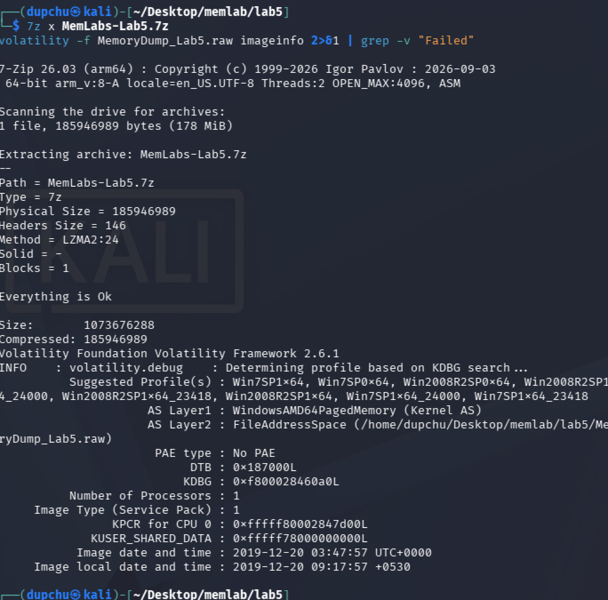
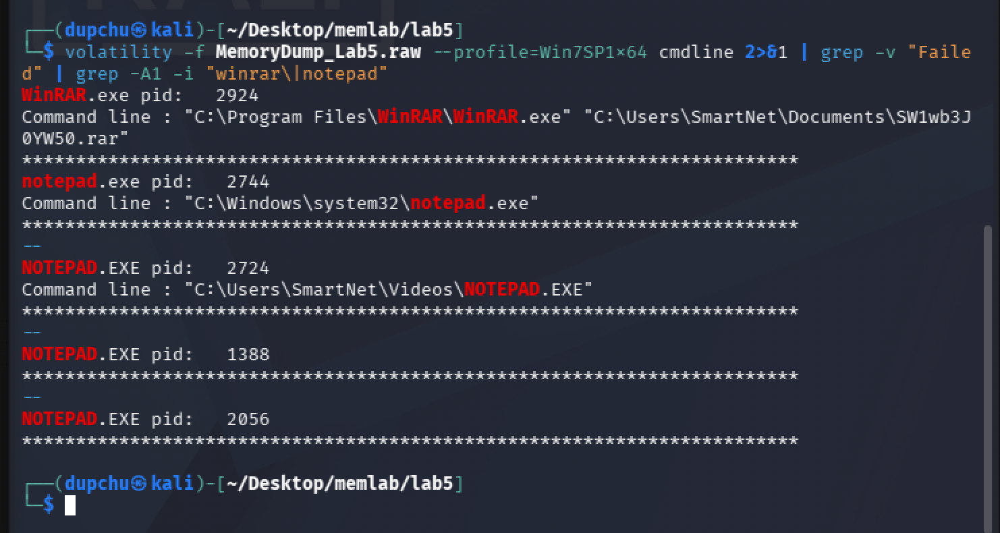
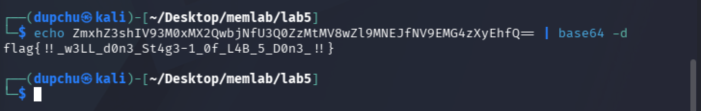
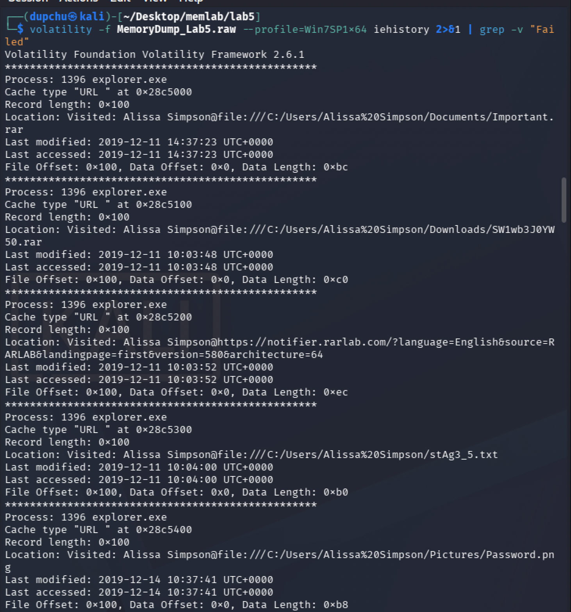
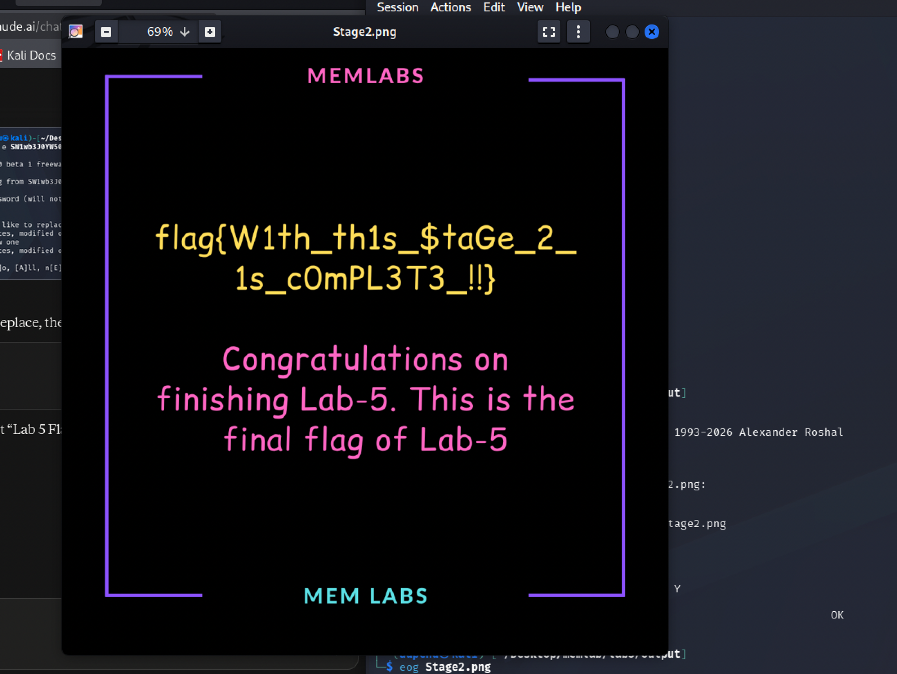

# MemLabs Lab 5 — Black Tuesday

## 1. Objective

Recover two flags from a Windows 7 memory image where an archive manager was in use. The first flag is required to unlock the second — the password for a RAR archive is derived from the first flag. The flag format is `flag{...}`.


## 2. Image Identification

I identified the operating system profile using the `imageinfo` plugin.

```
volatility -f MemoryDump_Lab5.raw imageinfo
```

**Result:** The suggested profile is **Win7SP1x64** (Windows 7, Service Pack 1, 64-bit). The image was captured on 2019-12-20 at 03:47:57 UTC.



## 3. Process Investigation

I examined process command-line arguments to identify what was running.

```
volatility -f MemoryDump_Lab5.raw --profile=Win7SP1x64 cmdline | grep -A1 -i "winrar\|notepad"
```

Key findings:

- **WinRAR.exe** (PID 2924) — had opened `C:\Users\SmartNet\Documents\SW1wb3J0YW50.rar`. The archive filename itself looks Base64-encoded (`SW1wb3J0YW50` decodes to `Important`).
- **notepad.exe** (PID 2744) — standard Notepad, nothing unusual.
- **NOTEPAD.EXE** (PID 2724) — launched from `C:\Users\SmartNet\Videos\NOTEPAD.EXE`, an unusual path for Notepad (legitimate Notepad lives in `C:\Windows\system32\`), suggesting this may be a suspicious or modified executable.



## 4. Flag 1 — Browser History (Base64-Encoded Filename)

### Investigation

The challenge description mentions files with names that were "not readable" and "composed of alphabets and numbers." This pointed toward encoded filenames in the user's file access history. I used the `iehistory` plugin to examine Internet Explorer and Windows Explorer browsing history:

```
volatility -f MemoryDump_Lab5.raw --profile=Win7SP1x64 iehistory
```

Among the many entries, several referenced a `.bmp` image file with a very long, encoded-looking filename:

```
Visited: Alissa Simpson@file:///C:/Windows/AppPatch/ZmxhZ3shIV93M0xMX2QwbjNfU3Q0ZzMtMV8wZl9MNEJfNV9EMG4zXyEhfQ.bmp
```

The filename `ZmxhZ3shIV93M0xMX2QwbjNfU3Q0ZzMtMV8wZl9MNEJfNV9EMG4zXyEhfQ` is clearly Base64-encoded. I decoded it:

```
echo ZmxhZ3shIV93M0xMX2QwbjNfU3Q0ZzMtMV8wZl9MNEJfNV9EMG4zXyEhfQ== | base64 -d
```

### Result

**Flag 1: `flag{!!_w3LL_d0n3_St4g3-1_0f_L4B_5_D0n3_!!}`**



### Why iehistory Was the Correct Plugin

This system used **Internet Explorer** as its browser, not Google Chrome. The `iehistory` plugin parses IE's `index.dat` cache files, which record URLs visited through the browser as well as files accessed through Windows Explorer (because Explorer uses the same `wininet.dll` library to track file access). This is different from the `chromehistory` community plugin used in Lab 2, which parses Chrome's SQLite history database. Choosing the correct browser-history plugin depends on identifying which browser was in use — `iehistory` for Internet Explorer (built into Volatility), `chromehistory` for Chrome (requires the community plugin pack). The `pslist` output confirmed no Chrome processes were running, while the `iehistory` output confirmed IE and Explorer were actively used.


## 5. Flag 2 — Password-Protected RAR Archive

### Investigation

I located the RAR archive in memory using `filescan`:

```
volatility -f MemoryDump_Lab5.raw --profile=Win7SP1x64 filescan | grep "SW1wb3J0YW50.rar"
```

**Result:** Found at offset `0x000000003eed56f0`.

I dumped and renamed the file:

```
volatility -f MemoryDump_Lab5.raw --profile=Win7SP1x64 dumpfiles -Q 0x000000003eed56f0 -D output/
mv output/file.None.*.dat output/SW1wb3J0YW50.rar
```

📸 *[Insert Screenshot: filescan and dumpfiles output for the RAR archive]*

The archive was password-protected. Using Flag 1 as the password:

```
unrar e SW1wb3J0YW50.rar
Enter password: flag{!!_w3LL_d0n3_St4g3-1_0f_L4B_5_D0n3_!!}
```

The archive extracted successfully, producing `Stage2.png`.



### Result

**Flag 2: `flag{W1th_th1s_$taGe_2_1s_cOmPL3T3_!!}`**



### Forensic Reasoning

The `dumpfiles` plugin extracts files from memory by following the `DataSectionObject` pointer in the file's `_FILE_OBJECT` kernel structure. Even though the RAR archive was password-protected on disk, the file itself could be extracted from memory as raw bytes — the encryption only applies when trying to extract the archive's contents, not to the archive file itself. The password was not stored alongside the archive but was encoded into the filename of a separate image file, requiring the investigator to cross-reference browser history artifacts with file system artifacts. This multi-step evidence chain — browser history reveals encoded filename, decoded filename is the password, password unlocks archive, archive contains flag — mirrors real-world investigations where evidence rarely sits in a single location.


## 6. Summary of Flags

| Flag | Value | Method |
|------|-------|--------|
| Flag 1 | `flag{!!_w3LL_d0n3_St4g3-1_0f_L4B_5_D0n3_!!}` | iehistory → Base64-encoded .bmp filename decoded |
| Flag 2 | `flag{W1th_th1s_$taGe_2_1s_cOmPL3T3_!!}` | Flag 1 as RAR password → Stage2.png |


## 7. Dead Ends and Additional Notes

- **NOTEPAD.EXE in Videos folder:** The `cmdline` output showed a `NOTEPAD.EXE` process (PID 2724) running from `C:\Users\SmartNet\Videos\`, which is not the legitimate Notepad path. This appears to be a suspicious or modified executable, potentially related to a third bonus flag mentioned in some writeups. However, as the assignment only requires two flags for Lab 5, this was noted but not pursued further.
- **RAR password entry:** The first attempt to enter the password via `unrar` failed due to copy-paste issues with special characters (`!`, `$`). Using `7z` with the `-p` flag also failed because 7z did not support the RAR5 encryption method. The solution was to carefully type the password manually into `unrar`, which succeeded.
- **The `chromehistory` plugin was not applicable** for this lab because no Chrome processes were running. The built-in `iehistory` plugin was the correct choice, as confirmed by the IE-related URLs and file access records it returned.
- **Archive filename encoding:** The archive itself was named `SW1wb3J0YW50.rar`, which Base64-decodes to `Important.rar` — another instance of Base64 encoding being used to obscure filenames, consistent with the challenge description's mention of unreadable filenames.